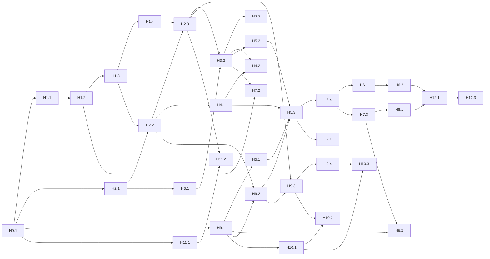

# Tablero del backlog

Reglas completas en [`AGENTS.md`](../../AGENTS.md). Diseño en [`docs/superpowers/specs/`](../superpowers/specs/2026-11-09-blockchain-integridad-design.md).

**Cómo tomar una historia:** `git switch main && git pull` → elige una `pendiente` con todas sus dependencias en `hecha` → crea la rama `h<épica>-<n>-<slug>` desde `main` → en su primer commit cambia `estado`, `tomada_por` y `fecha` en su archivo **y** en esta tabla → `git push -u` y PR en borrador. Se mezcla a `main` solo por PR; nunca se pushea directo a `main`.

## Reparto (acordado el 12 de noviembre)

Para terminar a tiempo, el trabajo restante se reparte así. La guía detallada para Alexis y su agente está en
[`docs/guia-alexis.md`](../guia-alexis.md) y el prompt listo para pegar en
[`docs/prompt-agente-alexis.md`](../prompt-agente-alexis.md).

| Quién                      | Historias                                                                                                              |
| -------------------------- | ---------------------------------------------------------------------------------------------------------------------- |
| **Juan Camilo** (hechas)   | H6.1, H6.2, H7.3, H8.1, H7.2, H3.3 y H4.2 (más todo lo anterior hasta H5.4)                                            |
| **Alexis** (en este orden) | H9.3, H7.1, H8.2, H9.4, H11.2 y H10.1                                                                                  |
| **Cierre** (cualquiera)    | H10.2, H10.3, H12.1, H12.3 y, tras el congelamiento del 20 de noviembre, H12.2 (se reparten según quién termine antes) |

## Disponibles ahora

Las dependencias ya están cumplidas y se pueden hacer en paralelo:

- **H7.1** Carga masiva CSV con firma por lotes.
- H12.1 (README) ya tiene sus dependencias; H12.2 (el informe) conviene dejarlo para después del congelamiento del 20 de noviembre.

## Tablero

| Historia                                        | Título                                                              | Depende de                               | Estado    | Tomada por  |
| ----------------------------------------------- | ------------------------------------------------------------------- | ---------------------------------------- | --------- | ----------- |
| [H0.1](H0.1-monorepo.md)                        | Monorepo con workspaces                                             | –                                        | hecha     | Claude      |
| [H0.2](H0.2-agents-y-config.md)                 | AGENTS.md, CLAUDE.md y configuración                                | H0.1                                     | hecha     | Claude      |
| [H0.3](H0.3-backlog.md)                         | Backlog de historias                                                | H0.2                                     | hecha     | Claude      |
| [H1.1](H1.1-serializacion-canonica.md)          | Serialización canónica                                              | H0.1                                     | hecha     | Juan Camilo |
| [H1.2](H1.2-hashes-y-genesis.md)                | Hashes SHA-256 y bloque génesis                                     | H1.1                                     | hecha     | Juan Camilo |
| [H1.3](H1.3-prueba-de-trabajo.md)               | Prueba de trabajo (minado)                                          | H1.2                                     | hecha     | Juan Camilo |
| [H1.4](H1.4-verificacion-de-cadena.md)          | Verificación completa de la cadena                                  | H1.3                                     | hecha     | Juan Camilo |
| [H2.1](H2.1-api-base.md)                        | API NestJS base con seguridad por defecto                           | H0.1                                     | hecha     | Juan Camilo |
| [H2.2](H2.2-crear-persona-y-cadena.md)          | Génesis, crear persona y consultar la cadena                        | H2.1, H1.3                               | hecha     | Juan Camilo |
| [H2.3](H2.3-verificar-cadena-api.md)            | Endpoint de verificación                                            | H2.2, H1.4                               | hecha     | Juan Camilo |
| [H3.1](H3.1-usuarios-y-login.md)                | Usuarios, contraseñas y login                                       | H2.1                                     | hecha     | Codex       |
| [H3.2](H3.2-guard-de-roles.md)                  | Control de acceso por roles                                         | H3.1, H2.3                               | hecha     | Codex       |
| [H3.3](H3.3-gestion-de-usuarios.md)             | Gestión de usuarios (admin)                                         | H3.2                                     | hecha     | Juan Camilo |
| [H4.1](H4.1-cifrado-aes.md)                     | Cifrado AES-256-GCM de dirección y teléfono                         | H2.2                                     | hecha     | Codex       |
| [H4.2](H4.2-respuestas-por-rol.md)              | Lo que ve cada rol                                                  | H4.1, H3.2                               | hecha     | Juan Camilo |
| [H5.1](H5.1-llaves-en-navegador.md)             | Llaves del usuario en el navegador                                  | H9.1                                     | hecha     | Juan Camilo |
| [H5.2](H5.2-registro-de-llaves.md)              | Registro, aprobación y rotación de llaves                           | H3.2                                     | hecha     | Juan Camilo |
| [H5.3](H5.3-flujo-preparar-firmar-confirmar.md) | Bloques firmados: preparar → firmar → confirmar                     | H5.1, H5.2, H4.1, H9.2                   | hecha     | Juan Camilo |
| [H5.4](H5.4-sello-del-servidor.md)              | Sello del servidor y cadena comprometida                            | H5.3                                     | hecha     | Juan Camilo |
| [H6.1](H6.1-modulo-de-ataques.md)               | Módulo de simulación de ataques                                     | H5.4                                     | hecha     | Juan Camilo |
| [H6.2](H6.2-restaurar-demo.md)                  | Snapshot y "Restaurar demo"                                         | H6.1                                     | hecha     | Juan Camilo |
| [H7.1](H7.1-carga-csv.md)                       | Carga masiva CSV con firma por lotes                                | H5.3                                     | pendiente |             |
| [H7.2](H7.2-bitacora.md)                        | Bitácora de auditoría encadenada                                    | H3.2, H1.2                               | hecha     | Juan Camilo |
| [H7.3](H7.3-exportar-cadena.md)                 | Exportar la cadena                                                  | H5.4                                     | hecha     | Juan Camilo |
| [H8.1](H8.1-cli-verificador.md)                 | CLI verificador independiente                                       | H7.3                                     | hecha     | Juan Camilo |
| [H8.2](H8.2-verificador-web.md)                 | Verificación local en el navegador                                  | H7.3, H9.1                               | hecha     | Alexis      |
| [H9.1](H9.1-web-base.md)                        | Web base: React + Vite, login y layout por rol                      | H0.1                                     | hecha     | Codex       |
| [H9.2](H9.2-paginas-personas-y-cadena.md)       | Páginas Personas y Cadena                                           | H9.1, H2.2                               | hecha     | Juan Camilo |
| [H9.3](H9.3-pagina-verificar.md)                | Página Verificar                                                    | H9.2, H2.3                               | hecha     | Alexis      |
| [H9.4](H9.4-paginas-admin-bitacora-csv.md)      | Páginas Admin, Bitácora, CSV y Exportar (se puede hacer por partes) | H9.3, H3.3, H5.2, H6.2, H7.1, H7.2, H7.3 | pendiente |             |
| [H10.1](H10.1-sistema-visual.md)                | Sistema visual                                                      | H9.1                                     | hecha     | Alexis      |
| [H10.2](H10.2-vista-cadena-visual.md)           | Cadena como bloques conectados                                      | H10.1, H9.3                              | hecha     | Alexis      |
| [H10.3](H10.3-pulido-y-modo-presentacion.md)    | Pulido y modo presentación                                          | H10.1, H9.4                              | pendiente |             |
| [H11.1](H11.1-ca-propia-https.md)               | CA propia y certificado HTTPS                                       | H0.1                                     | hecha     | Codex       |
| [H11.2](H11.2-docker-compose.md)                | Docker Compose con nginx TLS                                        | H11.1, H2.3                              | hecha     | Alexis      |
| [H12.1](H12.1-readme.md)                        | README del proyecto                                                 | H6.2, H8.1                               | en-curso  | Alexis      |
| [H12.2](H12.2-informe.md)                       | Informe final                                                       | (tras el congelamiento)                  | pendiente |             |
| [H12.3](H12.3-guion-sustentacion.md)            | Guion de sustentación y ensayo                                      | H12.1                                    | pendiente |             |

## Cronograma (qué debe estar hecho cada día, no quién lo hace)

| Fecha     | Meta                                   | Historias                      |
| --------- | -------------------------------------- | ------------------------------ |
| Lun 9 nov | E0 Fundaciones                         | H0.1–H0.3 ✅                   |
| Mar 10    | Núcleo criptográfico                   | H1.1–H1.4 (y H2.1 en paralelo) |
| Mié 11    | **Demo 1:** crear → bloque → verificar | H2.2, H2.3, H9.1, H9.2         |
| Jue 12    | Login y permisos                       | H3.1, H3.2, H3.3, H9.3         |
| Vie 13    | Cifrado                                | H4.1, H4.2                     |
| Sáb 14    | Llaves                                 | H5.1, H5.2                     |
| Dom 15    | **Demo 2:** firmados y sellados        | H5.3, H5.4                     |
| Lun 16    | Ataques                                | H6.1, H6.2                     |
| Mar 17    | CSV, bitácora y exportar               | H7.1, H7.2, H7.3               |
| Mié 18    | **Demo 3:** alcance completo           | H8.1, H8.2, H9.4               |
| Jue 19    | Infra + diseño                         | H11.1, H11.2, H10.1, H10.2     |
| Vie 20    | Cierre del diseño + **congelamiento**  | H10.3 + prueba del guion       |
| Sáb 21    | Documentación                          | H12.1, H12.2                   |
| Dom 22    | Ensayo + colchón                       | H12.3                          |

## Grafo de dependencias

**Ruta crítica:** H1.1 → H1.4 → H2.3 → H3.2 → H5.2 → H5.3 → H5.4 → H6.1/H7.3. Si los dos trabajan el mismo día, uno va por la ruta crítica y el otro por la web (H9.x), la infra (H11.x) o el diseño (H10.x).
