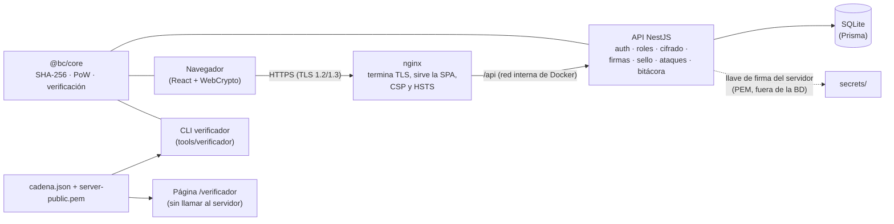
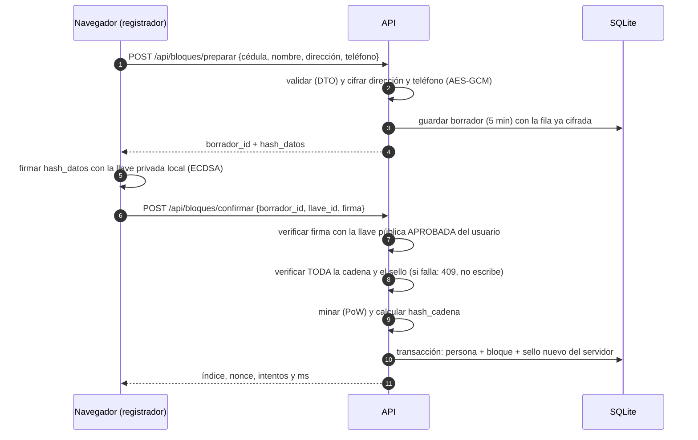

# Verichain: simulación de una blockchain con integridad verificable

**Proyecto final de Ciberseguridad — Universidad Icesi (Prof. Juan Manuel Madrid)**
**Proyecto 7: simulación de una blockchain**
**Equipo:** Juan Camilo y Alexis · **Versión del informe:** 21 de noviembre de 2026 (borrador)

> **Estado del documento.** Borrador completo en contenido; faltan las **capturas de pantalla** (marcadores
> `📷 CAPTURA PENDIENTE`, las toma una persona con la app corriendo), la **salida de `npm audit` del día de la entrega** y
> confirmar el **formato** que pide el profesor (este informe está en Markdown y se puede convertir a PDF o Word).
> Cada afirmación de seguridad cita el archivo del código o la prueba que la respalda; las rutas son relativas a la raíz
> del repositorio.

## Contenido

1. [Problema y enunciado](#1-problema-y-enunciado)
2. [Arquitectura](#2-arquitectura)
3. [Servicios de seguridad y justificación criptográfica](#3-servicios-de-seguridad-y-justificación-criptográfica)
4. [Matriz de permisos](#4-matriz-de-permisos)
5. [Codificación segura (OT3)](#5-codificación-segura-ot3)
6. [Resultados: los cinco ataques](#6-resultados-los-cinco-ataques)
7. [Pruebas y verificación](#7-pruebas-y-verificación)
8. [Limitaciones y riesgos aceptados](#8-limitaciones-y-riesgos-aceptados)
9. [Dependencias y `npm audit`](#9-dependencias-y-npm-audit)
10. [Consideraciones éticas (OT4)](#10-consideraciones-éticas-ot4)
11. [Conclusiones](#11-conclusiones)
12. [Anexos](#12-anexos)

---

## 1. Problema y enunciado

El enunciado (proyecto 7) pide una **blockchain sencilla** construida a partir de una tabla de datos sencilla (aquí,
personas con cédula, nombre, dirección y teléfono):

- La cadena **arranca con un solo bloque**, el **génesis**, y recibe **un bloque por cada registro**.
- Cada bloque contiene, además de los datos, **dos campos adicionales**: un **hash SHA-256 de los datos del bloque** y un
  **hash SHA-256 de todos los bloques anteriores y el actual** (se puede tomar el hash de los hashes).
- El programa permite **crear filas nuevas** y **verificar la integridad** de la cadena, **calculando los hashes en vivo**
  y comparándolos con los almacenados.

El proyecto se evalúa con **OT1** (diseñar e implementar un servicio que garantice confidencialidad, integridad y/o
disponibilidad) y **OT3** (buenas prácticas de codificación segura). Por eso no basta con que "funcione": el producto debe
**demostrar en vivo** que detecta manipulaciones, y cada decisión de seguridad debe tener una justificación.

### 1.1 Cómo se cumple cada requisito de la rúbrica

| Requisito                                                | Cómo se cumple                                                                                                                                    | Código y prueba                                                                                                                                  |
| -------------------------------------------------------- | ------------------------------------------------------------------------------------------------------------------------------------------------- | ------------------------------------------------------------------------------------------------------------------------------------------------ |
| Tabla de datos de personas                               | Modelo `Persona` (cédula única, nombre, dirección y teléfono cifrados).                                                                           | `apps/api/prisma/schema.prisma`; `apps/api/test/personas.e2e.test.ts`                                                                            |
| Arranca con un bloque génesis                            | Se crea solo al iniciar la API si la cadena está vacía (índice 0, `hash_anterior` = 64 ceros).                                                    | `apps/api/src/cadena/cadena.service.ts` (`onModuleInit`), `packages/core/src/genesis.ts`; `apps/api/test/api.e2e.test.ts`                        |
| Un bloque por cada registro                              | Cada persona nueva anexa exactamente un bloque (`Bloque.persona_id` es único).                                                                    | `apps/api/src/cadena/cadena.service.ts` (`anexarBloqueTx`); `apps/api/test/bloques.e2e.test.ts`                                                  |
| Hash SHA-256 de los datos del bloque                     | `hash_datos = SHA-256(serialización canónica de la fila)`.                                                                                        | `packages/core/src/hash.ts` (`calcularHashDatos`), `canonico.ts`; `packages/core/test/`                                                          |
| Hash SHA-256 de todos los bloques anteriores y el actual | `hash_cadena = SHA-256(hash_cadena_anterior ‖ hash_datos ‖ nonce)`: el "hash de los hashes".                                                      | `packages/core/src/hash.ts` (`calcularHashCadena`)                                                                                               |
| Crear filas nuevas                                       | Formulario en **Personas** y **carga masiva CSV**.                                                                                                | `apps/web/src/paginas/Personas.tsx`, `apps/web/src/componentes/CargaCsv.tsx`; `apps/web/test/personas.test.tsx`, `apps/api/test/csv.e2e.test.ts` |
| Verificar la integridad calculando los hashes en vivo    | `GET /api/cadena/verificar` recalcula todo desde los datos actuales y reporta, por bloque, qué chequeo falla y cuál es el **primer bloque roto**. | `packages/core/src/verificar.ts`, `apps/api/src/cadena/cadena.service.ts`; `apps/api/test/verificar.e2e.test.ts`                                 |

> 📷 **CAPTURA PENDIENTE (1):** página **Cadena** con el génesis y 3 bloques conectados. _Cómo:_ sesión de cualquier rol →
> **Cadena**.
> 📷 **CAPTURA PENDIENTE (2):** página **Verificar** con «✅ Cadena íntegra» y los 5 chequeos por bloque. _Cómo:_ sesión de
> auditor o admin → **Verificar** → **Verificar integridad**.

### 1.2 Lo que se agregó de más

Prueba de trabajo, cifrado AES-256-GCM de dirección y teléfono, login con roles, firma ECDSA del usuario en cada bloque,
sello digital del servidor, gestión y aprobación de llaves, módulo de simulación de ataques con _snapshot_ y "Restaurar
demo", bitácora de auditoría encadenada, exportación y verificadores independientes (CLI y navegador), carga masiva CSV,
HTTPS con CA propia, Docker Compose y una interfaz con modo presentación.

---

## 2. Arquitectura

### 2.1 Componentes



| Pieza           | Ruta                                      | Responsabilidad                                                                                           |
| --------------- | ----------------------------------------- | --------------------------------------------------------------------------------------------------------- |
| `@bc/core`      | `packages/core`                           | Serialización canónica, SHA-256, PoW y verificación. **Una sola implementación** para API, web y CLI.     |
| API             | `apps/api`                                | NestJS + Prisma + SQLite: autenticación, roles, cifrado, firmas, sello, ataques, bitácora y CSV.          |
| Web             | `apps/web`                                | React + Vite: personas, cadena, verificación, verificador local, usuarios, llaves, ataques y exportación. |
| CLI             | `tools/verificador`                       | Verifica un JSON exportado fuera del sistema.                                                             |
| Infraestructura | `infra/tls`, `infra/nginx`                | CA propia y certificado; configuración de nginx.                                                          |
| Contenedores    | `docker-compose.yml`, `apps/*/Dockerfile` | `api` (sin puertos al host) y `web` (nginx en 443 y 80→443).                                              |

`@bc/core` es **isomórfico**: no importa módulos de Node, así que corre igual en el servidor y en el navegador. Es lo que
permite que el verificador del navegador y el CLI den el mismo resultado que el servidor.

### 2.2 Modelo de datos y hashes

Tablas en `apps/api/prisma/schema.prisma`: `Usuario`, `LlaveUsuario`, `Borrador`, `Sello`, `Bitacora`, `Persona` y `Bloque`.

```text
hash_datos_i  = SHA-256( JSON canónico de la fila_i )        con dirección y teléfono CIFRADOS
hash_cadena_i = SHA-256( hash_cadena_{i-1} ‖ hash_datos_i ‖ nonce_i )     (empieza con N ceros: PoW)
génesis       : índice 0, datos "GENESIS", hash_anterior = 64 ceros
sello         = firma ECDSA P-256 del servidor sobre  "índice:hash_cadena"  del último bloque
firma_usuario = firma ECDSA P-256 del registrador, hecha en su navegador, sobre hash_datos
```

- La **serialización canónica** (`packages/core/src/canonico.ts`) fija el orden de los campos, usa JSON sin espacios, UTF-8 y
  fecha ISO-8601 UTC con milisegundos; rechaza campos de más o de menos. Así el mismo dato produce siempre los mismos bytes
  y la verificación nunca falla por un detalle de formato.
- Los **datos no se duplican** en el bloque: la verificación recalcula `hash_datos` a partir de la fila actual de `Persona`,
  que es literalmente "calcular los hashes en vivo y compararlos con los almacenados".

### 2.3 Flujo preparar → firmar → confirmar



Por qué así: el servidor **no puede firmar en nombre del usuario**, de modo que el usuario no puede negar que creó el
registro (no repudio). El borrador guarda la fila **ya cifrada** porque el IV es aleatorio y el hash se calcula sobre el
texto cifrado: no se podría recalcular después.

Código: `apps/api/src/bloques/bloques.service.ts` (`preparar`, `confirmar`), `apps/api/src/cadena/cadena.service.ts`
(`anexarBloqueTx`, `exigirCadenaIntegra`), `apps/web/src/paginas/Personas.tsx`; pruebas en
`apps/api/test/bloques.e2e.test.ts` (flujo, firma inválida, borrador de otro usuario, borrador expirado).

---

## 3. Servicios de seguridad y justificación criptográfica

Regla de todo el proyecto: **solo librerías probadas, nada de criptografía propia**. En `@bc/core` se usa `@noble/hashes`
(síncrono e isomórfico); en la API, el módulo `crypto` de Node; en el navegador, WebCrypto (`crypto.subtle`).

### 3.1 SHA-256 — integridad

- **Qué hace:** produce el `hash_datos` de cada fila y el `hash_cadena` que enlaza los bloques
  (`packages/core/src/hash.ts`).
- **Por qué SHA-256:** es una función de hash criptográfica con **resistencia a colisiones** (encontrar dos entradas
  distintas con el mismo hash es computacionalmente inviable), **resistencia a la preimagen** y **efecto avalancha**
  (cambiar un bit cambia el hash por completo). Eso hace que alterar un dato sea detectable y que no se pueda fabricar
  otro dato con el mismo hash.
- **Encadenamiento:** como `hash_cadena_i` incluye `hash_cadena_{i-1}`, alterar un bloque obliga a recalcular todos los
  siguientes (el "hash de los hashes" que pide el enunciado).
- **Por qué el hash se calcula sobre el texto cifrado:** (1) el verificador independiente comprueba la integridad **sin ver
  datos personales**; (2) se evita publicar hashes de datos de baja entropía, porque un teléfono se adivinaría por fuerza
  bruta a partir de su hash.
- **Pruebas:** `packages/core/test/` (determinismo de la serialización, vectores del hash, génesis).

### 3.2 AES-256-GCM — confidencialidad y autenticidad del texto cifrado

- **Qué cifra:** dirección y teléfono. La llave (`DATA_KEY`, 32 bytes en base64) vive solo en el entorno y se rechaza si no
  tiene el formato exacto (`apps/api/src/cripto/cifrado.service.ts`).
- **Formato:** `base64( IV de 12 bytes aleatorios ‖ tag de autenticación de 16 bytes ‖ texto cifrado )`. Cada cifrado usa un
  IV nuevo, así que el mismo dato produce textos distintos.
- **Por qué GCM:** es un modo **AEAD**: además de ocultar el dato autentica el texto cifrado. Si alguien altera el valor en
  la base de datos, el **tag falla al descifrar** y el dato se marca como corrupto (`ErrorDatoCorrupto`), nunca como un
  error 500 (`apps/api/src/cadena/cadena.service.ts`, `listarPersonasVisibles`).
- **Visibilidad por rol:** solo el registrador ve los datos descifrados; el auditor y el admin ven `***`.
- **Pruebas:** `apps/api/test/cifrado.test.ts`, `apps/api/test/personas-roles.e2e.test.ts`.
- **Limitación consciente:** cédula y nombre van en claro (ver §8).

### 3.3 ECDSA P-256 — no repudio y sello del servidor

- **Firma del usuario** (`apps/web/src/cripto/llaves.ts`): cada registrador genera su par ECDSA P-256 **en su navegador**
  con WebCrypto; la privada nunca sale de él sin cifrar (se guarda en IndexedDB y el respaldo se cifra con PBKDF2 +
  AES-GCM). Firma el `hash_datos` de cada registro; el servidor la verifica con la llave pública **aprobada por el admin**
  (`apps/api/src/cripto/verificador-firma.node.ts`) antes de minar.
- **Sello del servidor** (`apps/api/src/cripto/firma-servidor.service.ts`): cada vez que se anexa un bloque, el servidor
  firma `"índice:hash_cadena"` del último bloque con su propia llave, guardada en un PEM **fuera de la base de datos** con
  permisos 600 (`apps/api/scripts/llaves-servidor.mjs`). Sin esa llave la API no arranca.
- **Qué detecta el sello:** alguien con acceso solo a la base de datos que **altere un dato y recalcule todos los hashes y
  el PoW**, o que **borre los últimos bloques** (truncamiento). Ninguna de las dos cosas se detecta solo con hashes.
- **Llaves versionadas:** cada bloque guarda el `llave_id` con que se firmó; las llaves viejas no se borran, así los
  bloques antiguos siguen verificando. Registrar o rotar una llave **requiere aprobación del admin**
  (`apps/api/src/llaves/llaves.service.ts`).
- **Formato de firma:** IEEE-P1363 (64 bytes) sobre los bytes ASCII del mensaje, igual en Node y en WebCrypto
  (`apps/web/src/cripto/verificador-firma.web.ts`).
- **Pruebas:** `apps/api/test/sello.e2e.test.ts`, `apps/api/test/llaves.e2e.test.ts`,
  `apps/api/test/firma-servidor.test.ts`, `apps/api/test/verificador-firma.node.test.ts`,
  `apps/web/test/llaves.test.ts`, `apps/web/test/verificador-local.test.tsx`.

### 3.4 argon2id — contraseñas

- Las contraseñas se guardan con **argon2id** (`apps/api/src/auth/auth.service.ts`, `apps/api/src/usuarios/usuarios.service.ts`,
  `apps/api/src/auth/seed.ts`). argon2id es el ganador de la competencia de hashing de contraseñas y combina resistencia a
  ataques de GPU (memoria dura) y de canal lateral.
- **Política:** mínimo 12 caracteres, máximo 128 (evita abusar del costo de argon2) y distinta del usuario
  (`apps/api/src/usuarios/dto/crear-usuario.dto.ts`).
- **Sin enumeración de usuarios por tiempo:** si el usuario no existe, el login igualmente verifica contra un hash
  ficticio, de modo que el tiempo de respuesta no delata qué usuarios existen (`auth.service.ts`).
- **Pruebas:** `apps/api/test/auth.e2e.test.ts`, `apps/api/test/usuarios.e2e.test.ts`.

### 3.5 Prueba de trabajo (PoW)

- `hash_cadena` debe empezar con N ceros hexadecimales (por defecto N = 4, `POW_DIFFICULTY`); el bloque guarda el `nonce`
  encontrado (`packages/core/src/pow.ts`, `minar` y `cumpleDificultad`).
- **Por qué:** **encarece reescribir la cadena** (hay que volver a minar cada bloque posterior). Con un solo servidor la
  protección fuerte no es el PoW sino las firmas; el PoW es una capa más y hace visible el costo en la demostración. Con
  N = 4 minar toma de decenas a pocos cientos de milisegundos; con N = 5 puede tomar segundos.
- **Pruebas:** `packages/core/test/`, `apps/api/test/bloques.e2e.test.ts`.

### 3.6 Autenticación, sesión y control de acceso

- **JWT de vida corta** (15 min por defecto) en una **cookie** `httpOnly`, `SameSite=Strict` y `Secure` en producción
  (`apps/api/src/auth/auth.controller.ts`, `auth.service.ts`): el JavaScript de la página no puede leer el token y el
  navegador no lo envía en peticiones entre sitios.
- **Guards globales** (`apps/api/src/app.module.ts`): limitador de tasa → autenticación (JWT) → roles. Toda ruta exige
  sesión salvo las marcadas `@Publico()` (`login`, `salud`, `llave-servidor`).
- **Límite de intentos** (`@nestjs/throttler`): 100 solicitudes por minuto por IP en general y **5 por minuto en el login**.
- **Pruebas:** `apps/api/test/auth.e2e.test.ts`, `apps/api/test/roles.e2e.test.ts`, `apps/api/test/api.e2e.test.ts` (429).

### 3.7 PKI propia y HTTPS

- `infra/tls/generar-ca.sh` crea con `openssl` una **CA raíz propia** (ECDSA P-256) y un certificado para `localhost`
  firmado por ella; las llaves quedan en `secrets/tls/` (ignorado por git) con permisos 600. Se confía en la CA en el
  equipo del proyector (`infra/tls/README.md`); la CA no sale del equipo.
- nginx (`infra/nginx/default.conf`) sirve solo **TLS 1.2 y 1.3**, envía **HSTS** y redirige el puerto 80 a 443.
- Con HTTPS la cookie de sesión lleva `Secure` (`NODE_ENV=production` en `docker-compose.yml`).

### 3.7.1 Bitácora de auditoría encadenada

- Cada acción relevante (login, login fallido, preparar y crear bloque, verificar, exportar, ataque, restaurar, CSV) se
  registra en una tabla **solo de inserción** donde **cada entrada incluye el hash de la anterior**
  (`packages/core/src/bitacora.ts`, `apps/api/src/bitacora/bitacora.service.ts`). La página **Bitácora** verifica toda la
  cadena de la bitácora y señala la primera entrada rota.
- El detalle **no incluye contraseñas, llaves ni datos personales** (los lotes CSV registran solo conteos).
- **Pruebas:** `apps/api/test/bitacora.e2e.test.ts`, `apps/api/test/csv.e2e.test.ts` (una entrada por lote y sin datos
  personales).

### 3.8 Verificación independiente: no hace falta confiar en el servidor

- `GET /api/cadena/exportar` entrega un JSON (`bc-export/1`) con los bloques, las filas con los campos **cifrados**, las
  llaves públicas de los usuarios y el sello (`packages/core/src/exportacion.ts`).
- Se verifica con la **misma** lógica de `@bc/core` de dos maneras: el CLI `tools/verificador` y la página pública
  `/verificador`, que verifica **en el navegador sin llamar al servidor** (`apps/web/src/verificacion-local.ts`).
- **La llave pública del servidor no se toma del archivo:** la fija quien verifica (archivo `server-public.pem` aparte) y
  se compara su huella con la del JSON; si difieren se advierte y **siempre se usa la fijada**. Un archivo **sin sello**
  se considera comprometido (de lo contrario quitar el sello silenciaría la detección).
- **Pruebas:** `tools/verificador/test/` (fixtures reales: cadena válida, alterada y otra llave),
  `apps/web/test/verificador-local.test.tsx` (incluye una prueba que espía `fetch` y comprueba que no se llama).

> 📷 **CAPTURA PENDIENTE (3):** página **Verificador independiente** (`/verificador`) con «✅ Cadena íntegra» y la huella
> de la llave fijada. _Cómo:_ sin iniciar sesión, subir `cadena.json` y `server-public.pem` exportados desde **Exportar**.
> 📷 **CAPTURA PENDIENTE (4):** salida del CLI. _Cómo:_ `npx verificador cadena-….json --server-key server-public.pem`.

---

## 4. Matriz de permisos

Principios: **mínimo privilegio** (cada rol solo ve y hace lo necesario) y **separación de funciones** (nadie hace todo
solo: el admin no crea registros y el auditor comprueba la integridad sin ver datos personales).

| Acción                                    |         Admin         |   Registrador   |  Auditor   | Ruta (`apps/api/src/...`)                               |
| ----------------------------------------- | :-------------------: | :-------------: | :--------: | ------------------------------------------------------- |
| Gestionar usuarios                        |          ✅           |        –        |     –      | `usuarios/usuarios.controller.ts`                       |
| Aprobar o rechazar llaves                 |          ✅           |        –        |     –      | `llaves/llaves.controller.ts`                           |
| Registrar su propia llave y ver las suyas |           –           |       ✅        |     –      | `llaves/llaves.controller.ts`                           |
| Crear personas y cargar CSV               |           –           |       ✅        |     –      | `bloques/bloques.controller.ts`                         |
| Ver la tabla de personas                  |           –           | ✅ (descifrada) | ✅ (`***`) | `personas/personas.controller.ts`                       |
| Ver la cadena                             |          ✅           |       ✅        |     ✅     | `cadena/cadena.controller.ts` (`GET /cadena`)           |
| Verificar y exportar la cadena            |          ✅           |        –        |     ✅     | `cadena/cadena.controller.ts`                           |
| Ver la bitácora                           |          ✅           |        –        |     ✅     | `bitacora/bitacora.controller.ts`                       |
| Ataques, _snapshot_ y restaurar demo      | ✅ (solo `DEMO_MODE`) |        –        |     –      | `ataques/`, `demo/` (el módulo ni se registra sin demo) |
| Salud, login y llave pública del servidor |        público        |     público     |  público   | `salud/`, `auth/`, `cadena/` (`@Publico()`)             |

- **Implementación:** decorador `@Roles(...)` en cada ruta (`apps/api/src/auth/permisos.ts`) y `RolesGuard` global
  (`apps/api/src/auth/roles.guard.ts`). La interfaz repite la matriz en el menú (`apps/web/src/App.tsx`), pero la **fuente
  de verdad es la API**: ocultar un enlace no protege nada.
- **Pruebas:** `apps/api/test/roles.e2e.test.ts` y `apps/api/test/personas-roles.e2e.test.ts` (403 al rol equivocado, 401 sin
  sesión), `apps/api/test/ataques-sin-demo.e2e.test.ts` (sin `DEMO_MODE` las rutas no existen: 404),
  `apps/web/test/app.test.tsx` (menú por rol), `apps/web/test/admin.test.tsx` ("Sin permiso").

---

## 5. Codificación segura (OT3)

| Medida                                                                                                                                                                                                   | Dónde se aplica                                                                                                                                                                               | Prueba                                                                                                                                                              |
| -------------------------------------------------------------------------------------------------------------------------------------------------------------------------------------------------------- | --------------------------------------------------------------------------------------------------------------------------------------------------------------------------------------------- | ------------------------------------------------------------------------------------------------------------------------------------------------------------------- |
| **Validación de toda entrada** con DTO y `class-validator`; `ValidationPipe` global con `whitelist`, `forbidNonWhitelisted` y `transform`                                                                | `apps/api/src/configurar-app.ts`; DTO en `apps/api/src/*/dto/` y `personas/dto/crear-persona.dto.ts` (cédula 6–10 dígitos, nombre con regex de letras, teléfono numérico, longitudes máximas) | `apps/api/test/personas.e2e.test.ts` (entradas inválidas, normalización), `apps/api/test/api.e2e.test.ts` (campo extra → 400), `apps/api/test/usuarios.e2e.test.ts` |
| **Sin inyección SQL:** solo Prisma con consultas parametrizadas; no hay `$queryRaw*` ni `$executeRaw*` en el código propio                                                                               | `apps/api/src/prisma/prisma.service.ts` y todo `apps/api/src` (el único `$executeRaw` está en el código generado por Prisma)                                                                  | `apps/api/test/personas.e2e.test.ts` (los campos inválidos se rechazan antes de llegar a la BD)                                                                     |
| **Sin XSS:** React escapa la salida; no se usa `dangerouslySetInnerHTML`; la regex del nombre rechaza `<`, `=`, etc.                                                                                     | `apps/web/src` (búsqueda sin coincidencias); `personas/dto/crear-persona.dto.ts`                                                                                                              | `apps/web/test/personas.test.tsx`; `apps/api/test/csv.e2e.test.ts` (`=HYPERLINK(...)`)                                                                              |
| **CSP estricta en nginx** (`default-src 'self'`, sin scripts ni estilos en línea, `frame-ancestors 'none'`) y `X-Content-Type-Options`, `Referrer-Policy`, HSTS                                          | `infra/nginx/default.conf`; no hay atributos `style` en `apps/web/src`                                                                                                                        | Comprobación manual: `curl -I https://localhost` (ver `docs/guia-pruebas.md` §H)                                                                                    |
| **`helmet`** (cabeceras seguras en la API)                                                                                                                                                               | `apps/api/src/configurar-app.ts`                                                                                                                                                              | `apps/api/test/api.e2e.test.ts`                                                                                                                                     |
| **CORS** restringido al origen del frontend                                                                                                                                                              | `apps/api/src/configurar-app.ts` (solo se refleja `WEB_ORIGIN`)                                                                                                                               | `apps/api/test/api.e2e.test.ts`                                                                                                                                     |
| **Límite de intentos**: 100/min global y 5/min en el login                                                                                                                                               | `apps/api/src/app.module.ts`, `apps/api/src/auth/auth.controller.ts`                                                                                                                          | `apps/api/test/api.e2e.test.ts` (429)                                                                                                                               |
| **Cookie de sesión** `httpOnly`, `SameSite=Strict`, `Secure` en producción                                                                                                                               | `apps/api/src/auth/auth.controller.ts`                                                                                                                                                        | `apps/api/test/auth.e2e.test.ts`                                                                                                                                    |
| **Errores genéricos** al cliente, sin trazas de pila; el detalle va a la bitácora y los logs                                                                                                             | `apps/api/src/comun/filtro-excepciones.ts`                                                                                                                                                    | `apps/api/test/api.e2e.test.ts` (error interno sin traza)                                                                                                           |
| **Secretos fuera del repositorio:** `.env` y `secrets/` ignorados; cada variable documentada en `.env.example`; las imágenes Docker no los incluyen                                                      | `.gitignore`, `.dockerignore`, `.env.example`                                                                                                                                                 | `git ls-files` no contiene `.env` ni llaves (solo fixtures públicos de prueba)                                                                                      |
| **Comparación segura** de firmas con funciones de la librería (`verify`), no con `===` sobre secretos                                                                                                    | `apps/api/src/cripto/verificador-firma.node.ts`, `apps/web/src/cripto/verificador-firma.web.ts`                                                                                               | `apps/api/test/verificador-firma.node.test.ts`                                                                                                                      |
| **Carga CSV segura:** parser real (`csv-parse`, no `split`), 200 KB y 500 filas como máximo, solo `.csv` con tipo MIME de CSV, encabezado exacto, registros de hasta 4096 bytes, archivo solo en memoria | `apps/api/src/bloques/bloques.controller.ts`, `apps/api/src/bloques/bloques.service.ts` (`prepararLote`)                                                                                      | `apps/api/test/csv.e2e.test.ts` (17 pruebas)                                                                                                                        |
| **Una sola conexión SQLite sin bloqueos y anexos en cola** (un anexo a la vez; un borrador no se confirma dos veces)                                                                                     | `apps/api/src/comun/cola.ts`, `apps/api/src/cadena/cadena.service.ts`                                                                                                                         | `apps/api/test/bloques.e2e.test.ts`                                                                                                                                 |
| **`trust proxy` de un solo salto** detrás de nginx (la bitácora y el límite ven la IP real; desactivado por defecto para que nadie falsee su IP)                                                         | `apps/api/src/configurar-app.ts`, `docker-compose.yml` (`TRUST_PROXY`)                                                                                                                        | `apps/api/test/trust-proxy.test.ts`                                                                                                                                 |
| **Contenedor mínimo:** usuario no root (uid 1000), API sin puertos al host, solo dependencias de producción                                                                                              | `apps/api/Dockerfile`, `docker-compose.yml`                                                                                                                                                   | Comprobación manual: `docker compose exec api id -u` ≠ 0                                                                                                            |
| **Linter que prohíbe** `eval`, `new Function` y `any` explícito                                                                                                                                          | `eslint.config.mjs`                                                                                                                                                                           | `npm run lint` (parte de `npm run check`)                                                                                                                           |
| **Modo demo apagado por defecto**: sin `DEMO_MODE=true` los módulos de ataques y restaurar **no se registran**                                                                                           | `apps/api/src/app.module.ts`, `apps/api/src/ataques/modo-demo.ts`                                                                                                                             | `apps/api/test/ataques-sin-demo.e2e.test.ts`                                                                                                                        |

Revisión final de seguridad (búsqueda en `apps/`): sin `dangerouslySetInnerHTML`, sin `$queryRawUnsafe` ni
`$executeRawUnsafe`, sin atributos `style` en línea y sin `any` explícito en el código propio.

---

## 6. Resultados: los cinco ataques

El módulo de ataques (solo admin y solo con `DEMO_MODE=true`) simula a alguien con **acceso directo a la base de datos**.
Cada ataque tiene su prueba automática y se puede ver en vivo en la página **Ataques**
(`apps/api/src/ataques/ataques.service.ts`). Tras cada uno se usa **Restaurar demo** (volver al _snapshot_).

| #   | Ataque (`id`)       | Qué hace                                                 | Qué lo detecta                                                      | Prueba automática                                                      |
| --- | ------------------- | -------------------------------------------------------- | ------------------------------------------------------------------- | ---------------------------------------------------------------------- |
| 1   | `modificar-dato`    | Cambia el nombre de una persona directo en la tabla      | **`hash_datos`** (y `hash_cadena`) del bloque atacado               | `apps/api/test/ataques.e2e.test.ts` («modificar-dato…»)                |
| 2   | `modificar-cifrado` | Altera el texto cifrado de dirección o teléfono          | **`hash_datos`** y el **tag de AES-GCM** al descifrar               | `apps/api/test/ataques.e2e.test.ts` («modificar-cifrado…»)             |
| 3   | `reescribir-cadena` | Altera un dato y **recalcula todos los hashes y el PoW** | **Firma del usuario** y **sello del servidor** (los hashes cuadran) | `apps/api/test/ataques.e2e.test.ts`, `apps/api/test/sello.e2e.test.ts` |
| 4   | `truncar`           | Borra el último bloque (la cadena parece válida)         | **Sello del servidor** (apunta a un bloque que ya no existe)        | `apps/api/test/ataques.e2e.test.ts`, `apps/api/test/sello.e2e.test.ts` |
| 5   | `reordenar`         | Intercambia dos bloques                                  | **Enlace** `hash_anterior`                                          | `apps/api/test/ataques.e2e.test.ts` («reordenar…»)                     |

**Efectos de la cadena comprometida:** mientras la verificación o el sello fallen, el servidor **rechaza anexar** nuevos
bloques (HTTP 409 «Cadena comprometida: restaure antes de continuar»), de modo que un ataque no se "lava" agregando un
sello nuevo (`apps/api/test/sello.e2e.test.ts`, «con la cadena alterada, confirmar da 409»).

> 📷 **CAPTURAS PENDIENTES (5 a 9), una por ataque.** _Cómo:_ admin → **Ataques** → **Tomar snapshot** → índice del bloque
> (≥ 1) → **Ejecutar ataque** → **Verificar ahora** → captura del reporte con el bloque y el chequeo en ❌ → **Restaurar demo**.
> Orden y resultado esperado en la tabla de arriba. Para el ataque 1 hay además la versión manual:
> `sqlite3 apps/api/data/blockchain.db "UPDATE Persona SET nombre='Mallory' WHERE id=1;"`.
> 📷 **CAPTURA PENDIENTE (10):** página **Cadena** con el bloque atacado en rojo tras **Verificar cadena**.

---

## 7. Pruebas y verificación

`npm run check` ejecuta formato, lint, tipos y las pruebas de todos los workspaces. Resultado al 21 de noviembre de 2026
(en verde):

| Workspace         | Archivos de prueba | Pruebas |
| ----------------- | -----------------: | ------: |
| `@bc/core`        |                  7 |     102 |
| `@bc/api`         |                 21 |     244 |
| `@bc/web`         |                 12 |     163 |
| `@bc/verificador` |                  1 |      15 |
| **Total**         |                 41 | **524** |

Las pruebas de la API son de extremo a extremo con una base de datos temporal y llaves de prueba; las de la web simulan
la API y ejercitan WebCrypto e IndexedDB en jsdom. Además se probó a mano, con la aplicación real:

- el flujo completo de la demo (usuarios, llaves, bloques firmados, CSV, ataques, restaurar, exportar, bitácora);
- Docker: redirección 301 de HTTP a HTTPS, TLS 1.1 rechazado, HSTS y CSP presentes, API sin puerto en el host,
  contenedor con uid 1000 e imagen sin `.env` ni llaves, y login de admin con cookie `Secure`;
- carga de 500 filas por CSV: preparar ≈ 0,5 s y confirmar ≈ 2,5 s (la cadena se verifica una vez por lote).

La guía para repetirlo paso a paso, por punto de la rúbrica, está en [`docs/guia-pruebas.md`](../guia-pruebas.md).

---

## 8. Limitaciones y riesgos aceptados

| Limitación                                                                                           | Por qué se acepta / mitigación                                                                                                                                                                                                     |
| ---------------------------------------------------------------------------------------------------- | ---------------------------------------------------------------------------------------------------------------------------------------------------------------------------------------------------------------------------------- |
| **Rollback completo de la base de datos** a un estado antiguo y coherente (cadena + sellos antiguos) | Es exactamente lo que hace «Restaurar demo» (también devuelve usuarios y bitácora). En un sistema de un solo servidor no se puede evitar; como trabajo futuro, **anclar el sello fuera del servidor** (publicarlo periódicamente). |
| **Confianza en el admin al aprobar llaves**                                                          | Quien controle el servidor y la BD podría registrar una llave falsa. Se mitiga con la aprobación explícita del admin (mostrando la **huella** antes de aprobar) y la bitácora encadenada, pero no se elimina.                      |
| **Cédula y nombre en claro**                                                                         | Decisión consciente: la dirección y el teléfono van cifrados; cédula y nombre permanecen en claro para identificar el registro. Se declara aquí.                                                                                   |
| **Un solo servidor**                                                                                 | El enunciado no pide red P2P ni consenso; el diseño lo declara como no-objetivo.                                                                                                                                                   |
| **Borrar entradas del final de la bitácora** no se detecta solo con su encadenamiento                | El encadenamiento detecta alteraciones y borrados en el medio; truncar el final requeriría anclar el último hash fuera (igual que el sello de la cadena).                                                                          |
| **El PoW del verificador usa la dificultad que trae el archivo**                                     | Por eso la protección fuerte es el **sello** (firma), cuya llave fija quien verifica; el PoW es una capa adicional.                                                                                                                |
| **Una llave extraíble en IndexedDB queda al alcance de un XSS**                                      | Mitigado con CSP estricta, sin `dangerouslySetInnerHTML` y sin estilos ni scripts en línea; la llave no se exporta sin la contraseña del respaldo.                                                                                 |
| **Límite de intentos por IP**, no por cuenta                                                         | Suficiente para la demostración; un despliegue real añadiría bloqueo por cuenta y MFA.                                                                                                                                             |
| **Datos personales de demostración**                                                                 | Todo el material de prueba es ficticio (ver §10).                                                                                                                                                                                  |

---

## 9. Dependencias y `npm audit`

Salida de `npm audit` al **21 de noviembre de 2026** (resumen): **12 vulnerabilidades — 9 moderadas y 3 altas.**

```text
effect  <=3.22.0                       Severity: high
  ReDoS en el regex compilado de Schema.TemplateLiteral (GHSA-7589-6fvf-x4pw)
  └─ @prisma/config  >=6.13.0-dev.1  →  prisma  >=6.13.0-dev.1
  fix: npm audit fix --force  (instalaría prisma@6.12.0: cambio incompatible)

minimatch  7.0.0 - 11.0.0              Severity: moderate
  DoS por amplificación de globparts (GHSA-g3hv-75wg-m249)
  └─ @eslint/config-array, @typescript-eslint/*, typescript-eslint, eslint
  fix: npm audit fix  (sin cambios incompatibles)

12 vulnerabilities (9 moderate, 3 high)
```

> ⚠️ **Antes de entregar:** volver a ejecutar `npm audit` y `npm audit --omit=dev` y pegar aquí la salida de ese día.

### 9.1 Cómo se trata cada hallazgo

| Hallazgo                                                  | ¿Entra al producto?                                                                                                                                                                                                             | Tratamiento                                                                                                                                                                                                                                                                                                                                                                                                                                                                        |
| --------------------------------------------------------- | ------------------------------------------------------------------------------------------------------------------------------------------------------------------------------------------------------------------------------- | ---------------------------------------------------------------------------------------------------------------------------------------------------------------------------------------------------------------------------------------------------------------------------------------------------------------------------------------------------------------------------------------------------------------------------------------------------------------------------------- |
| `effect` ≤ 3.22.0 (alta) vía `@prisma/config` → `prisma`  | Sí, por la **CLI de Prisma**: `prisma` está en `dependencies` de `@bc/api` porque el contenedor ejecuta `prisma migrate deploy` al arrancar (`apps/api/Dockerfile`). Con `npm audit --omit=dev` siguen apareciendo las 3 altas. | **Riesgo aceptado.** La vulnerabilidad es un ReDoS en un regex del esquema de configuración de la CLI; esa ruta solo procesa el `schema.prisma` y la configuración **propios**, nunca entradas de usuarios, y corre una vez al iniciar el contenedor, no en las peticiones. La corrección automática (`--force`) **baja Prisma a 6.12.0**, un cambio incompatible que rompería el adaptador de SQLite que usamos (Prisma 7). Se revisará cuando haya un parche de `effect`/Prisma. |
| `minimatch` (moderada) vía `eslint` y `typescript-eslint` | **No.** Solo herramientas de lint en desarrollo; no entran a las imágenes (`npm ci --omit=dev` en los Dockerfile).                                                                                                              | **Riesgo aceptado** (solo desarrollo). Existe arreglo sin cambios incompatibles (`npm audit fix`); como el código está congelado, se documenta y se puede aplicar después con `npm run check` en verde.                                                                                                                                                                                                                                                                            |

Medidas de cadena de suministro ya aplicadas: criptografía solo con librerías probadas (`@noble/hashes`, `crypto` de Node,
WebCrypto, `argon2`), `package-lock.json` versionado, instalación con `npm ci` en las imágenes, solo dependencias de
producción en el contenedor y TypeScript fijado a `~6.0` por compatibilidad con `typescript-eslint`.

---

## 10. Consideraciones éticas (OT4)

- **Datos personales de terceros.** El sistema maneja cédula, nombre, dirección y teléfono. Todo el material de demostración
  y de pruebas usa **datos ficticios** (por ejemplo `docs/ejemplos/personas.csv`); no se cargaron datos de personas reales.
  Como diseño, el sistema aplica **minimización y mínimo privilegio**: dirección y teléfono van **cifrados**, el auditor
  verifica la integridad **sin ver** datos personales, el verificador independiente trabaja con los campos cifrados y la
  bitácora no guarda datos personales ni secretos.
- **Cédula y nombre en claro.** Es una limitación que se declara abiertamente (§8): en un despliegue real habría que cifrarlos
  o seudonimizarlos y cumplir la normativa de protección de datos aplicable (en Colombia, la Ley 1581 de 2012).
- **Uso responsable del módulo de ataques.** Los ataques **alteran deliberadamente** la base de datos. Por eso solo existen
  con `DEMO_MODE=true` (el módulo ni se registra si no), solo el admin los ejecuta, quedan en la bitácora y hay un _snapshot_
  para restaurar. **Nunca deben activarse en producción**, y las técnicas se usaron únicamente contra el propio sistema
  y con fines educativos.
- **Honestidad sobre las garantías.** El informe no promete más de lo que el sistema ofrece: detalla qué detecta y qué no
  (§6 y §8), y no presenta la simulación como una blockchain distribuida real.
- **Secretos y llaves.** Las llaves privadas de los usuarios nunca salen de su navegador sin cifrar; los secretos del
  servidor viven fuera del repositorio. La CA propia es solo para el entorno de demostración y debe retirarse del almacén de
  confianza al terminar.
- **Uso de herramientas de IA.** Parte del código y de la documentación se produjo con asistentes de IA bajo la dirección
  del equipo, con revisión humana, pruebas automáticas y el flujo de ramas y _pull requests_ del repositorio.
  <!-- Confirmar con el equipo cómo se debe declarar este uso según la política de la asignatura. -->

---

## 11. Conclusiones

- El requisito del enunciado se cumple y se **puede demostrar**: la cadena arranca con el génesis, cada registro agrega un
  bloque con su hash de datos y su hash encadenado, y la verificación recalcula todo en vivo y señala el primer bloque roto.
- Los hashes solos no bastan: un atacante con acceso a la base de datos puede **recalcular toda la cadena** o **truncarla**.
  Las **firmas** (usuario y servidor) cierran esa brecha; el PoW solo encarece el ataque.
- La **confidencialidad** (AES-GCM, roles) y la **verificación independiente** (CLI y navegador, con la llave del servidor
  fijada por quien verifica) hacen que no sea necesario confiar en el servidor para comprobar la integridad.
- La **codificación segura** se aplicó por capas y con pruebas (524 pruebas automáticas en verde), y las limitaciones
  restantes —rollback de la base de datos, confianza en el admin, datos en claro, un solo servidor— están declaradas.
- Trabajo futuro: anclar el sello fuera del servidor, cifrar cédula y nombre, MFA y bloqueo por cuenta, múltiples nodos con
  consenso y actualizar las dependencias señaladas por `npm audit`.

---

## 12. Anexos

### 12.1 Cómo reproducir

```bash
git clone <repositorio> && cd <repositorio>
npm install && cp .env.example .env            # completar JWT_SECRET, DATA_KEY y ADMIN_PASSWORD
npm run llaves:servidor -w @bc/api
npm run build -w @bc/core
(cd apps/api && npx prisma migrate deploy)
npm run seed -w @bc/api
npm run dev -w @bc/api        # terminal 1
npm run dev -w @bc/web        # terminal 2  →  http://127.0.0.1:5173
npm run check                 # formato, lint, tipos y 524 pruebas
```

Con Docker: `bash infra/tls/generar-ca.sh && docker compose up --build -d` (ver [`README.md`](../../README.md)).

### 12.2 Documentos relacionados

- Diseño: [`docs/superpowers/specs/2026-11-09-blockchain-integridad-design.md`](../superpowers/specs/2026-11-09-blockchain-integridad-design.md)
- Resumen de lo implementado: [`docs/resumen-proyecto.md`](../resumen-proyecto.md)
- Guía de pruebas por rúbrica: [`docs/guia-pruebas.md`](../guia-pruebas.md)
- Guion de sustentación: [`docs/sustentacion.md`](../sustentacion.md)
- Backlog y estado: [`docs/backlog/README.md`](../backlog/README.md)

### 12.3 Historias de trabajo (backlog)

| Épica | Qué cubre                                               | Historias   |
| ----- | ------------------------------------------------------- | ----------- |
| E0    | Monorepo, reglas para agentes y backlog                 | H0.1–H0.3   |
| E1    | Núcleo criptográfico (`@bc/core`)                       | H1.1–H1.4   |
| E2    | API de la cadena                                        | H2.1–H2.3   |
| E3    | Autenticación, roles y usuarios                         | H3.1–H3.3   |
| E4    | Cifrado y respuestas por rol                            | H4.1–H4.2   |
| E5    | Llaves, firma del usuario y sello del servidor          | H5.1–H5.4   |
| E6    | Ataques y restaurar demo                                | H6.1–H6.2   |
| E7    | CSV, bitácora y exportación                             | H7.1–H7.3   |
| E8    | Verificador independiente (CLI y navegador)             | H8.1–H8.2   |
| E9    | Interfaz funcional                                      | H9.1–H9.4   |
| E10   | Sistema visual, cadena como bloques y modo presentación | H10.1–H10.3 |
| E11   | CA propia y Docker Compose                              | H11.1–H11.2 |
| E12   | README, informe y guion de sustentación                 | H12.1–H12.3 |

### 12.4 Variables de entorno

Documentadas en [`.env.example`](../../.env.example): `JWT_SECRET`, `JWT_EXPIRES_IN`, `ADMIN_USERNAME`, `ADMIN_PASSWORD`,
`DATA_KEY`, `SERVER_SIGNING_KEY_PATH`, `POW_DIFFICULTY`, `DEMO_MODE`, `WEB_ORIGIN`, `DATABASE_URL`, `PORT` y `TRUST_PROXY`.
**Ninguna se guarda en el repositorio.**
